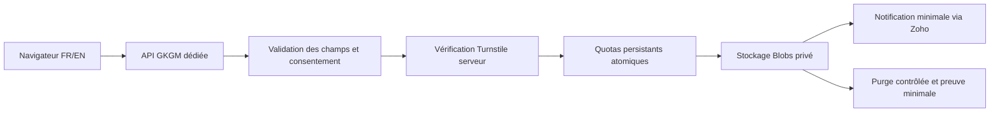

# GKGM — Phase A : étude de la collecte sécurisée

16 octobre 2026 · PR #7 · branche `codex/gkgm-project-inquiry`.

**Statut : recommandation à approuver, pas une architecture déployée.** Aucun code de collecte, stockage, variable, compte, abonnement ou service n’est modifié. Aucun POST public ni test de charge n’est réalisé. Cette étude examine le dépôt et la documentation officielle ; elle ne constitue pas un audit des consoles Netlify/Zoho ou des déploiements accessibles.

## 1. Conclusion proposée

Remplacer **uniquement la collecte GKGM** par une **API Netlify Function dédiée, dans un projet de collecte séparé, écrivant dans Netlify Blobs privé**. Ajouter Turnstile vérifié côté serveur, limitation de débit native et quotas applicatifs atomiques persistants. Notifier par l’API Zoho Mail existante avec un message minimal, sans les réponses du client.

Le navigateur appellera directement cette API GKGM, éventuellement sur un sous-domaine dédié. Une URL publique de cette API est normale : tout appel, direct ou issu du formulaire, doit traverser les mêmes validations. La protection repose sur l’absence de chemin public d’écriture dans le stockage et sur les contrôles serveur, pas sur la discrétion de l’URL ou une clé visible.

Le projet séparé évite de partager le stockage avec les aperçus du site institutionnel. Pas de modification des routes ni du collecteur `international-partnerships`. Le maintien de cette solution sans abonnement supplémentaire reste conditionné aux droits et crédits du compte existant ; aucun engagement payant n’est autorisé.

## 2. Architecture actuelle et chemins d’ingestion

| Chemin | Constat dans le dépôt | Risque / vérification encore nécessaire |
| --- | --- | --- |
| Navigateur → `/api/gkgm-project` | `components/forms/GkgmProjectForm.js`, `app/api/gkgm-project/route.js`, `lib/gkgm-project-server.js`. Requis, parcours, consentement, taille, champs inconnus et honeypot contrôlés avant transfert. | Un client HTTP peut fabriquer Origin ; ce contrôle n’est ni une authentification ni une limitation de débit. Le code actuel n’a pas de quota partagé. |
| API → `https://<SITE_NAME>.netlify.app/__gkgm-forms.html` | Le serveur utilise Netlify Forms comme destination finale. | Le collecteur ne dépend pas de la validation de cette API. |
| Client HTTP → collecteur natif GKGM | `public/__gkgm-forms.html` déclare publiquement `gkgm-project-inquiry` et ses champs. | Un POST direct avec `form-name` peut contourner l’API. Le chemin HTML, la racine et les chemins reconnus par Netlify doivent être testés avec autorisation ; bloquer un seul chemin ne prouve pas l’absence d’un autre. La documentation décrit les POST AJAX et les définitions statiques SSR. [Source](https://docs.netlify.com/manage/forms/setup/) |
| Autres domaines et déploiements | Domaine principal, alias `*.netlify.app`, Deploy Previews et anciennes URL immuables peuvent exposer une définition ou un ancien code. | Inventaire réel non disponible dans le dépôt. Retirer le fichier source seul ne prouve pas que le formulaire déjà enregistré cesse d’accepter des données. |
| Autre formulaire public | `public/__forms.html` déclare `international-partnerships`, avec nom, e-mail et description libre ; `PartnershipForm.js` poste vers son collecteur. | Il peut recevoir un texte relatif à un projet GKGM. Il doit rester indépendant : aucune importation automatique de ses données dans la nouvelle collection ou notification GKGM. |
| Accès privilégiés et intégrations | Console, jetons de compte, anciennes notifications, webhooks, scripts et autres sites possibles. | Non inventoriés à distance. Ces capacités doivent être recensées ; aucun droit d’écriture destiné au navigateur ne sera créé. Les administrateurs restent dans le périmètre des accès de confiance. |

**Périmètre vérifiable visé :** aucune demande ne peut entrer dans la nouvelle collection GKGM validée ni déclencher sa notification sans passer par l’API. Préserver un autre formulaire public empêche d’affirmer qu’aucun texte de projet ne pourra jamais être enregistré ailleurs dans le compte.

## 3. Comparaison des options

| Option | Ingestion et compatibilité | Coût mensuel indicatif | Maintenance, données et suppression |
| --- | --- | --- | --- |
| Netlify Forms + API actuelle | Ne satisfait pas l’objectif : collecteur natif indépendant. Compatible avec le site mais validation contournable. | Inclus selon forfait ; les offres actuelles à crédits indiquent les soumissions Forms gratuites. | Simple ; console et notifications créent plusieurs copies. Le tri après réception ne corrige pas l’ingestion. Écartée. |
| **Function Netlify dédiée + Blobs privé** | Écriture par le serveur uniquement, si aucune route générique d’écriture/lecture n’est publiée. Compatible sans migrer Next.js. Projet de collecte séparé des aperçus. | **Pas de nouvel abonnement envisagé**, consommation des crédits Netlify existants. Forfait réel, disponibilité et budget à confirmer. | Complexité modérée : quotas, idempotence et suivi de notification à programmer. Suppression par clé, relecture de contrôle, registre minimal ; rétention interne fournisseur à établir. Recommandée pour le faible volume. |
| API Netlify + Postgres privé (ex. Supabase) | Bon contrôle avec rôle serveur restreint, aucun INSERT anonyme/authentifié et aucune RPC publique d’écriture. Ne pas exposer une clé privilégiée ; si Data API active, vérifier toutes les politiques et fonctions accessibles. | Free : 0 USD sous quotas, avec risque de pause ; Pro annoncé à partir de **25 USD/mois**, non autorisé ici. | Transactions, recherche et suivi de notification plus simples ; davantage de gestion SQL, rôles, sauvegardes et nouveau prestataire. Bon choix pour un futur outil de dossiers, moins économique aujourd’hui. |
| Worker Cloudflare + D1 privé | Liaison serveur à la base ; Worker public validant chaque appel. Next.js reste sur Netlify. | Free sous quotas ; Workers Paid démarre à **5 USD/mois**, non autorisé. | SQL et quotas transactionnels possibles ; nouveau backend, déploiement, compte et traitement de données hors Netlify à maintenir. Solution alternative si Blobs ne satisfait pas les exigences de conservation ou de compte. |

Supabase : [prix](https://supabase.com/pricing), [pause Free](https://supabase.com/docs/guides/platform/free-project-pausing), [politiques RLS](https://supabase.com/docs/guides/database/postgres/row-level-security), [sauvegardes](https://supabase.com/docs/guides/platform/backups). Free peut être mis en pause après une faible activité sur sept jours ; les sauvegardes doivent être étudiées séparément, sans exporter inutilement les données.

Cloudflare : [Workers](https://developers.cloudflare.com/workers/platform/pricing/), [D1](https://developers.cloudflare.com/d1/platform/pricing/), [restauration](https://developers.cloudflare.com/d1/reference/time-travel/). Le niveau gratuit annonce 100 000 requêtes Worker/jour, et pour D1 5 millions de lignes lues/jour, 100 000 écrites/jour et 5 Go au total. Un dépassement gratuit peut interrompre le service ; ce n’est pas une garantie de disponibilité ou une autorisation de passer au payant. Les historiques de restauration restent à intégrer à la politique de suppression.

## 4. Fonctionnement recommandé, à implémenter après accord

La limitation native filtre aussi les tentatives avant la fonction ; des compteurs techniques transitoires peuvent exister pour les requêtes rejetées, mais aucun dossier ou contenu de projet ne doit y être enregistré.

### Entrée unique et stockage

- API d’ingestion autorisant uniquement POST, corps de taille limitée, schéma strict et normalisation des six parcours, options et consentement. Aucun document sensible, champ inconnu ou choix de clé de stockage accepté.
- Retirer le transfert vers Netlify Forms et la définition statique GKGM après approbation. Remplacer l’ancienne route applicative par un refus explicite ou le même traitement sécurisé, sans ancien fallback. Les alias de la Function doivent tous appliquer ce traitement.
- Collections distinctes pour dossiers, compteurs techniques et preuve de purge ; identifiants aléatoires générés par le serveur, sans e-mail dans les clés ou métadonnées. Aucun accès anonyme à Blobs, aucune URL signée de dépôt, aucun endpoint générique `set/get/delete` accessible au public.
- Cohérence forte et écritures conditionnelles pour les compteurs et transitions d’état. Une incrémentation « lire puis écrire » sans contrôle de concurrence est exclue. En cas de conflit répété ou de panne du quota/stockage, refuser temporairement sans stocker le dossier.
- Production et test dans des projets distincts, pas seulement des préfixes. Ne pas donner de secrets ou de données de production aux Deploy Previews. Contrôler les droits du compte, du dépôt et des dépendances ; seul Edem Yawo Awutey est habilité à consulter les dossiers.

[Netlify Blobs](https://docs.netlify.com/build/data-and-storage/netlify-blobs/) documente accès via le site, cohérence forte, écritures atomiques conditionnelles et suppression par clé. Un store de site est partagé entre ses déploiements : d’où la séparation des projets. Le stockage n’apporte pas à lui seul l’authentification d’une route que nous écririons. L’absence de chemin public d’écriture reste à tester en phase B ; la purge applicative ne prouve pas l’effacement physique des sauvegardes du fournisseur.

### Antispam et consommation

- Turnstile côté navigateur, **vérifié par l’API avec le secret serveur**, en contrôlant succès, hostname attendu et action. Refus si jeton absent, expiré, rejoué, destiné à un autre environnement ou si la vérification est indisponible. Le honeypot reste un complément.
- Limitation native de la Function sur chaque alias exposé ; ne pas transposer automatiquement une configuration de Function à une route Next.js générée par l’adaptateur.
- Proposition initiale à valider : 10 tentatives/minute/IP en amont ; admission de 3 dossiers/heure/IP et 3/jour/contact ; plafond de 100 dossiers/jour pour le service. Ces valeurs sont ajustables : NAT partagés et personnes sans accès au challenge exigent un recours par contact, pas un chemin d’écriture sans contrôle.
- Quotas applicatifs partagés entre instances et alias, avec incréments atomiques et horodatage serveur. Utiliser l’IP établie par la plateforme, pas un en-tête client arbitraire ; HMAC avec secret pour les identifiants IP/contact, rétention technique courte proposée de 48 h. Ce sont encore des données pseudonymisées, à inclure dans la notice.
- Le plafond global est un coupe-circuit et peut aussi être épuisé par un attaquant ; il limite l’exposition du stockage, pas toutes les requêtes et tous les crédits. Alertes de consommation et limites du compte à contrôler. Aucune promesse de blocage de tous les bots ou de coût nul en cas d’attaque.

[Turnstile](https://developers.cloudflare.com/turnstile/get-started/server-side-validation/) impose la validation serveur ; ses jetons durent cinq minutes et sont à usage unique. Son [offre gratuite](https://developers.cloudflare.com/turnstile/plans/) nécessite un compte Cloudflare et un nouvel examen des données techniques traitées. La clé publique du widget ne donne aucun accès au stockage.

La [limitation Netlify](https://docs.netlify.com/manage/security/secure-access-to-sites/rate-limiting/) est programmable sur tous les forfaits, mais peut prendre jusqu’à dix secondes à s’appliquer. La limite par domaine et IP n’est pas un plafond global ; elle doit donc être complétée par les quotas persistants ci-dessus.

### Enregistrement, erreurs et notification

- Une demande validée est enregistrée avec `receivedAt`, échéance calculée depuis cette réception initiale, version du schéma/notice et état de notification. Ne jamais enregistrer un dossier rejeté ni journaliser son contenu.
- Clé d’idempotence aléatoire conservée en mémoire du formulaire pour les réessais, associée à une empreinte serveur du contenu. Elle ne donne aucun droit de lecture. Les appels répétés ne créent pas plusieurs dossiers ; après modification, nouvelle tentative clairement identifiée. Une ancienne clé avec un contenu différent est rejetée.
- Confirmation seulement après écriture réussie. Si la notification échoue ensuite, la demande reste enregistrée et la notification est reprise à partir de cet enregistrement ; ne pas demander au client de renvoyer le dossier. Après timeout ambigu, le même identifiant de tentative permet de résoudre le résultat sans exposer les réponses.
- E-mail Zoho fixé côté serveur vers `gk.contactus@gkgroup.app` : « Nouvelle demande GKGM validée », référence aléatoire et indication de consultation dans l’espace privé. Pas de nom, e-mail client, WhatsApp, description, pièce jointe ou lien de lecture public. Aucun destinataire fourni par le navigateur.
- Reprise de notification avec verrou et essais bornés, sans dupliquer le contenu du dossier dans une file. Un doublon de message minimal peut subsister après une panne entre envoi Zoho et confirmation : ne pas promettre une livraison exactement une fois. Une erreur persistante remonte au responsable sans données client.
- Consultation initiale via le compte Netlify habilité, sans nouvelle interface d’administration publique. Téléchargements éventuels recensés et supprimés ; l’ajout ultérieur d’un espace dossiers nécessiterait authentification et autorisations propres.

L’[API Zoho Mail](https://www.zoho.com/mail/help/api/post-send-an-email.html) utilise [OAuth](https://www.zoho.com/mail/help/api/using-oauth-2.html). L’accès API, le droit d’envoi, les limites et la région du compte GKGM restent à vérifier ; aucun nouvel abonnement d’envoi n’est proposé par défaut.

### Conservation et suppression

- `receivedAt` est fixé au serveur et ne change pas lors d’un réessai. Demandes sans suite : maximum 12 mois calendaires depuis réception initiale ; aucun report au dernier échange.
- Purge automatique quotidienne proposée, en plus du contrôle hebdomadaire d’Edem Yawo Awutey. Anticiper le délai technique de suppression et l’échéance entre deux exécutions ; surveiller les échecs et l’arrêt éventuel du service pour crédits épuisés. Une tâche désactivée ne constitue pas une garantie de suppression.
- Tâche privilégiée sans dépôt de dossier possible, supprimant uniquement les clés sélectionnées par l’échéance serveur. Relecture en cohérence forte pour vérifier l’absence ; preuve minimale séparée (identifiant opaque, date, résultat, opérateur/tâche), sans copie du dossier. Sa propre durée de conservation doit être approuvée.
- Retirer aussi les anciens enregistrements Forms GKGM, notifications contenant des données et copies internes selon la procédure approuvée. Les nouveaux e-mails minimaux réduisent les duplications, sans supprimer leur caractère de métadonnées à gérer.
- Vérifier les politiques réelles de sauvegarde/récupération Netlify et Zoho et les éventuels exports. Une lecture « absent » prouve une suppression logique accessible, pas une purge physique de toutes les sauvegardes. Fixer l’anticipation ou traiter cette incompatibilité avant activation ; réappliquer les suppressions après restauration.
- Dossiers devenus clients : politique distincte à approuver, aucun transfert automatique de tous les dossiers dans une rétention indéfinie.

## 5. Comptes, secrets et budget nécessaires

| Élément | Besoin proposé | Visibilité / condition |
| --- | --- | --- |
| Compte Netlify existant | Nouveau projet de collecte, Blobs et Functions ; tests sur un projet sans données de production. | Aucun compte payant créé. Vérifier droits, quotas et rétention du compte. |
| Accès Blobs | Contexte serveur du projet de collecte ; pas de jeton personnel large dans le navigateur. | Accès de déploiement/administration restreint ; aucun secret de production dans les aperçus. |
| Cloudflare Turnstile Free | Widget, hostname/action de production et environnement de test séparé. | Sitekey publique ; secret de vérification côté serveur uniquement. Nouveau traitement technique à valider. |
| Zoho existant | Application OAuth et autorisation d’envoi pour la boîte officielle. | Client secret et refresh token privés ; account ID/client ID/configuration non publics par défaut. Droit minimal d’envoi, région adaptée. |
| Quotas et idempotence | Secret HMAC et paramètres de seuil. | Secret serveur géré hors Git/GitHub et hors `NEXT_PUBLIC_*`. Rotation et durée des pseudonymes à documenter. |
| Déploiement | Configuration du projet de collecte et domaine éventuel. | Phase B seulement, après accord ; aucun déploiement autorisé par la seule étude. |

Les [offres Netlify à crédits](https://docs.netlify.com/manage/accounts-and-billing/billing/billing-for-credit-based-plans/credit-based-pricing-plans/) affichent Blobs parmi les fonctions incluses, 2 crédits/10 000 requêtes web, 10 crédits/Go-heure Functions et 15 crédits/déploiement de production. Exemple de calcul, pas un devis : 1 000 demandes, une invocation d’une seconde à 1 Go chacune, représentent environ 2,8 crédits de calcul + 0,2 de requêtes, **hors** vérifications supplémentaires, notifications, purge, trafic, stockage applicable et rejets/attaques. La latence des services externes augmente le calcul. Les tarifs et le forfait effectif doivent être vérifiés avant engagement ; l’inclusion de Blobs ne constitue pas un tarif contractuel garanti à terme.

Objectif budgétaire : **0 USD d’abonnement supplémentaire**, à faible volume dans les crédits existants et avec API Zoho déjà disponible. Ce n’est pas une garantie de facture totale inchangée. Si une option manque ou dépasse le budget, arrêter et demander une autorisation, sans changement de forfait ni recharge automatique.

## 6. Migration et preuves requises en phase B

1. Approbation explicite de cette architecture, de Turnstile, des seuils initiaux, du traitement des données techniques et du budget. Vérifier le compte et les conditions de sauvegarde avant de prétendre satisfaire la conservation.
2. Implémenter hors production le handler unique, accès privé, quotas concurrents, idempotence, notification minimale, purge et protections des opérations administratives. Aucun fallback vers Forms.
3. Préserver les six parcours, quatre étapes, FR/EN, design, état en mémoire, consentement, métadonnées et sitemap. Tester la régénération du challenge expiré sans perte des réponses.
4. Inventorier puis retirer la définition et les notifications **GKGM uniquement**. Désenregistrer le formulaire natif GKGM déjà existant et traiter ses anciennes données sous autorisation ; une suppression est irréversible et ne doit pas être improvisée. Empêcher d’anciens builds de le recréer. Ne pas désactiver Forms au niveau du site, puisque les partenariats l’utilisent.
5. Après autorisation d’un test distant contrôlé : ancienne URL HTML/racine, alias Netlify, anciens aperçus, API directe, alias Function et accès de stockage sans identifiants. Vérifier que les rejets ne créent **ni dossier GKGM ni notification GKGM** ; contrôler le stockage, pas uniquement le code HTTP.
6. Tester jetons manquants/forgés/rejoués et hostname/action incorrects, champs inconnus, absence de consentement, toutes catégories, concurrence et quotas répartis sur plusieurs instances/alias, panne du limiteur (refus), tentative d’accès au store et absence de secrets dans les bundles/logs.
7. Tester stockage réussi avec notification en panne, timeout ambigu et réessais identiques, accès non autorisé à la consultation et aux tâches de purge, suppression d’un dossier synthétique et preuve minimale, ancien dossier au seuil de rétention, absence de perte des réponses aux erreurs.
8. Lint/build/tests FR/EN, SEO et partenariats. Aucun script de stress ne doit consommer les crédits de production. Faire relire les résultats avant activation et fusion.

Les anciens chemins publics et les permissions du stockage n’ont pas encore été testés à distance. L’étude ne conclut donc pas « sécurité garantie » ; elle propose une architecture dont l’absence de contournement devra être démontrée sur la configuration retenue.

## 7. Décision demandée

Approuver ou amender : **API GKGM dans un projet Netlify dédié + Blobs privé + Turnstile Free + quotas partagés + notification minimale Zoho**, sans achat ni activation implicite. La collection sécurisée GKGM sera indépendante du formulaire public de partenariats maintenu à l’identique. La phase B reste suspendue à cet accord.
