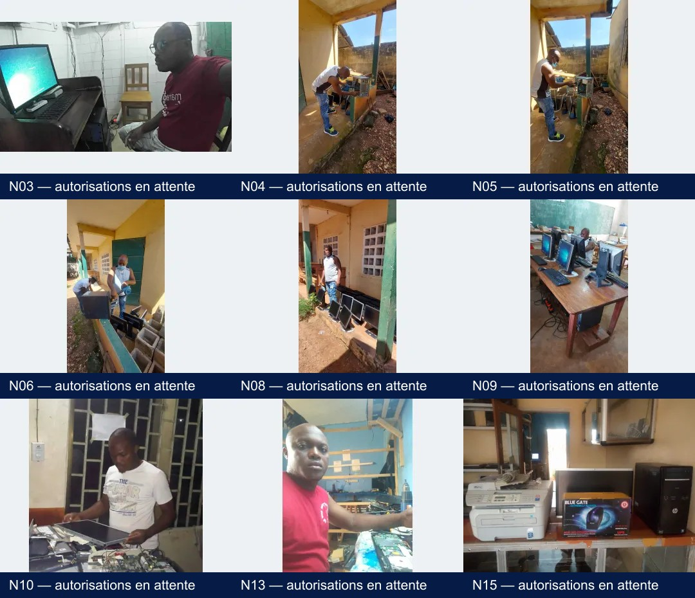
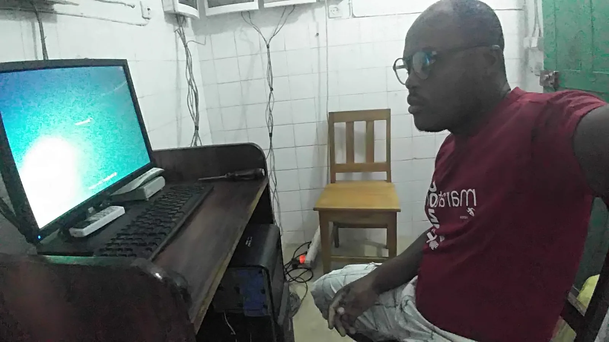
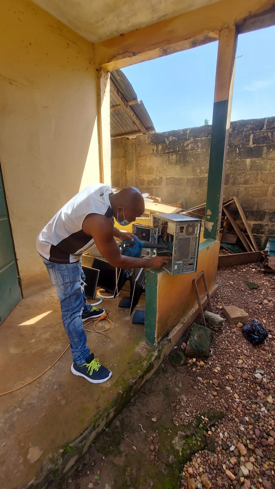
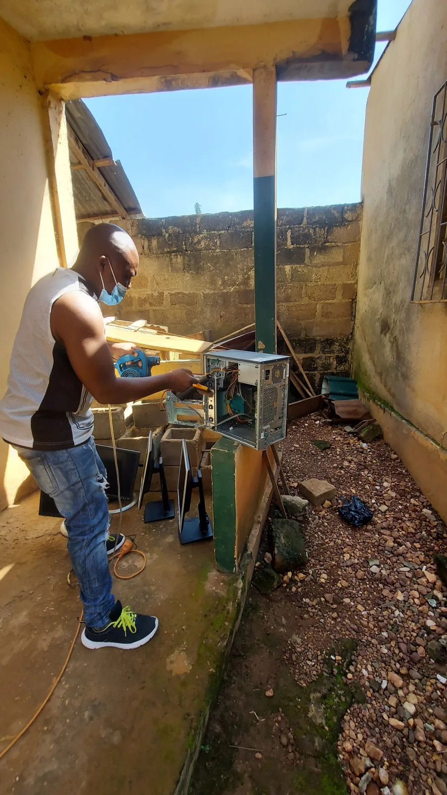
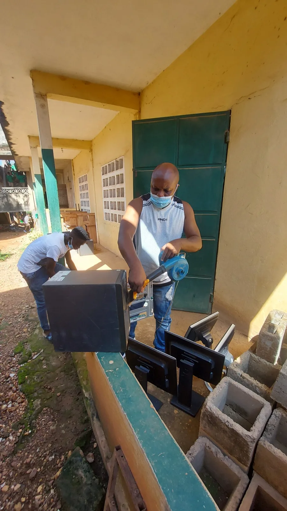
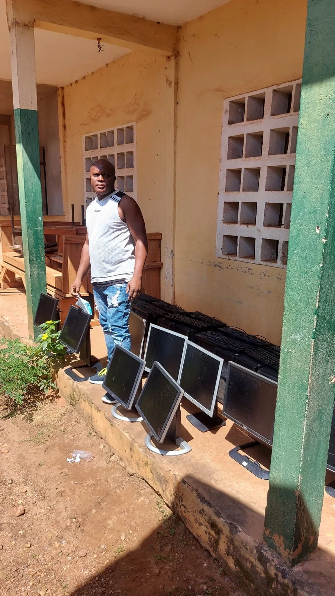
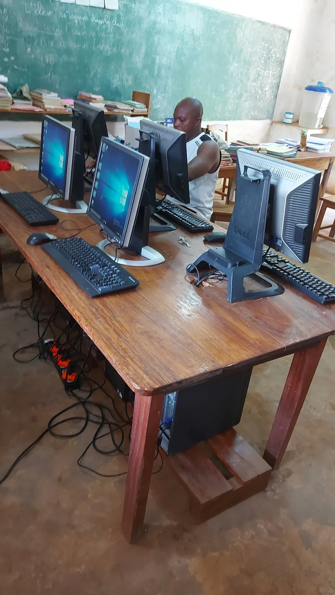
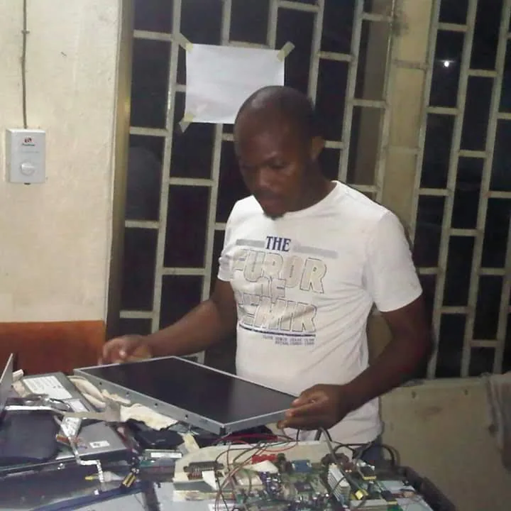
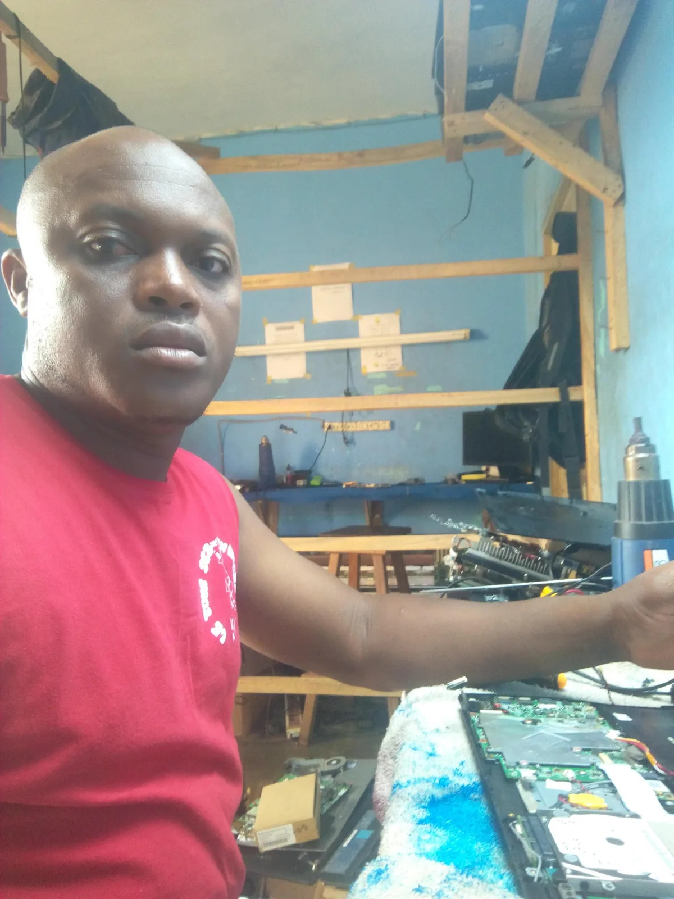
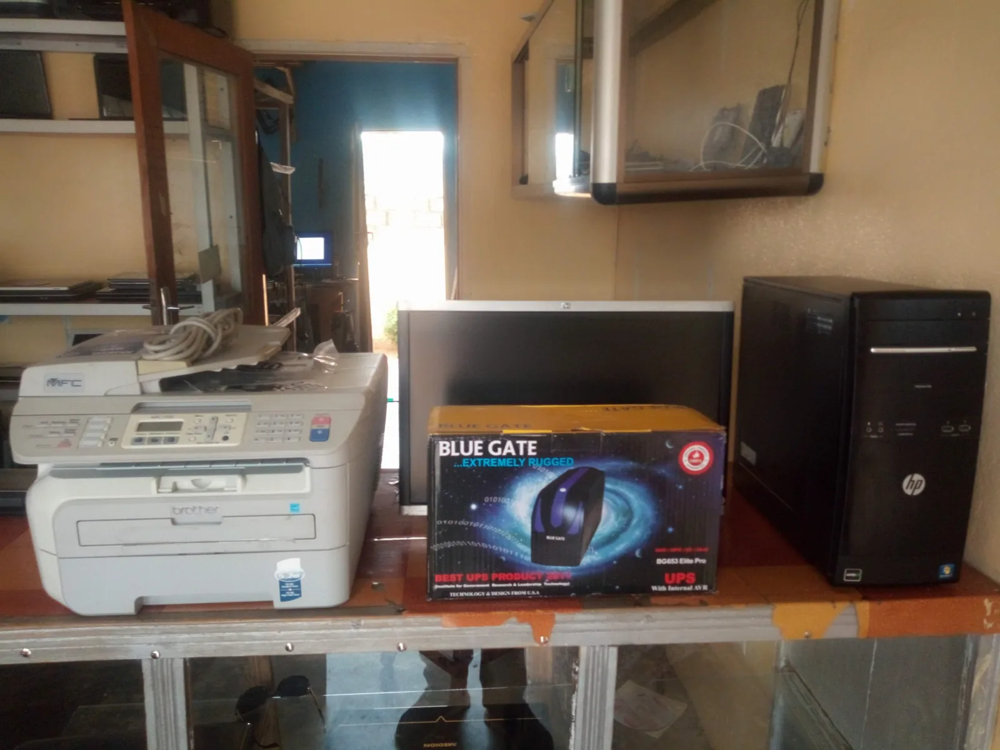

# GKGT — Revue des neuf nouvelles photographies avant autorisation

**Statut : en attente de votre confirmation. Aucun statut technique modifié.** La galerie conserve 21 vues distinctes ; les six doublons restent dans les originaux, sans second affichage. Les 15 fichiers sources et les 12 archives validées restent intacts.

Les identifiants ci-dessous correspondent aux copies affichées dans la galerie locale. Les descriptions servent à repérer les personnes ; aucun nom, lien d’emploi ou accord individuel n’est déduit de leur apparence. Une personne déjà autorisée sur une autre photographie ne vaut pas automatiquement autorisation de cette nouvelle vue.

## Trois confirmations distinctes

1. **Droit à l’image des personnes :** confirmer leur accord pour les vues concernées sur gkgroup.app, y compris les personnes d’arrière-plan. Ne pas communiquer de pièce d’identité pour cette revue.
2. **Confidentialité :** confirmer votre examen des écrans, documents, étiquettes, reflets et autres informations visibles ; signaler ce qui doit rester non public ou faire l’objet d’un traitement décidé séparément. L’accord d’une personne ne règle pas automatiquement ces éléments.
3. **Autres droits :** confirmer votre droit de publication du fichier photographique et les contenus de tiers pertinents. La présence d’une marque n’est pas présentée ici comme la preuve qu’un accord constructeur existe ou qu’une autorisation supplémentaire est forcément requise.

## N03 — 20181129_082000(1).jpg

- **Original :** source-assets/gkgt-authentic-15/originals/20181129_082000(1).jpg
- **Copie de galerie :** public/gkgt-activities/n03.webp
- **Personnes / droit à l’image :** Une personne en haut rouge et lunettes, de profil devant le portable. Accord de publication à confirmer pour la ou les personnes concernées.
- **Confidentialité distincte :** Contenu de l’écran du portable ; absence de nom, compte ou donnée de client à confirmer.
- **Autres droits / provenance :** Auteur et droit de publication de la photographie à confirmer.
- **Décision actuelle :** autorisation générale et statut de publication toujours en attente. Aucune suppression, retouche ou levée de réserve exécutée.

## N04 — 20211013_092705(1).jpg

- **Original :** source-assets/gkgt-authentic-15/originals/20211013_092705(1).jpg
- **Copie de galerie :** public/gkgt-activities/n04.webp
- **Personnes / droit à l’image :** Une personne en haut clair, penchée sur une unité centrale ; visage partiellement visible. Accord de publication à confirmer pour la ou les personnes concernées.
- **Confidentialité distincte :** Étiquettes, numéros et informations éventuellement visibles sur les équipements ; ne pas déduire une localisation.
- **Autres droits / provenance :** Auteur et droit de publication à confirmer.
- **Décision actuelle :** autorisation générale et statut de publication toujours en attente. Aucune suppression, retouche ou levée de réserve exécutée.

## N05 — 20211013_092710(1).jpg

- **Original :** source-assets/gkgt-authentic-15/originals/20211013_092710(1).jpg
- **Copie de galerie :** public/gkgt-activities/n05.webp
- **Personnes / droit à l’image :** Une personne en haut clair, portant un masque, à côté de l’unité centrale. Accord de publication à confirmer pour la ou les personnes concernées.
- **Confidentialité distincte :** Étiquettes et numéros sur le matériel ; aucune valeur n’est transcrite.
- **Autres droits / provenance :** Auteur et droit de publication à confirmer. Aucune identité n’est déduite de la ressemblance avec N04.
- **Décision actuelle :** autorisation générale et statut de publication toujours en attente. Aucune suppression, retouche ou levée de réserve exécutée.

## N06 — 20211013_092719(1).jpg

- **Original :** source-assets/gkgt-authentic-15/originals/20211013_092719(1).jpg
- **Copie de galerie :** public/gkgt-activities/n06.webp
- **Personnes / droit à l’image :** Deux personnes visibles : une au premier plan manipulant un écran, une autre penchée à l’arrière-plan. Accord de publication à confirmer pour la ou les personnes concernées.
- **Confidentialité distincte :** Étiquettes des écrans et matériels ; arrière-plan à examiner dans la copie agrandie.
- **Autres droits / provenance :** Accords à confirmer pour les deux personnes, pas seulement celle au premier plan ; droit du photographe à confirmer.
- **Décision actuelle :** autorisation générale et statut de publication toujours en attente. Aucune suppression, retouche ou levée de réserve exécutée.

## N08 — 20211013_100026(1).jpg

- **Original :** source-assets/gkgt-authentic-15/originals/20211013_100026(1).jpg
- **Copie de galerie :** public/gkgt-activities/n08.webp
- **Personnes / droit à l’image :** Une personne en haut clair debout près des moniteurs, visage visible. Accord de publication à confirmer pour la ou les personnes concernées.
- **Confidentialité distincte :** Éventuelles étiquettes d’équipement et détails du lieu ; aucun lieu ni date affirmé.
- **Autres droits / provenance :** Auteur et droit de publication à confirmer.
- **Décision actuelle :** autorisation générale et statut de publication toujours en attente. Aucune suppression, retouche ou levée de réserve exécutée.

## N09 — 20211013_113451(1).jpg

- **Original :** source-assets/gkgt-authentic-15/originals/20211013_113451(1).jpg
- **Copie de galerie :** public/gkgt-activities/n09.webp
- **Personnes / droit à l’image :** Une personne assise derrière les écrans, visage partiellement visible. Accord de publication à confirmer pour la ou les personnes concernées.
- **Confidentialité distincte :** Écrans allumés, tableau écrit, livres et documents en arrière-plan. Ne pas présumer leur innocuité à partir de leur lisibilité réduite.
- **Autres droits / provenance :** Vérifier les contenus de tiers éventuellement reproduits et l’autorisation de présenter l’environnement, sans l’attribuer à des locaux actuels.
- **Décision actuelle :** autorisation générale et statut de publication toujours en attente. Aucune suppression, retouche ou levée de réserve exécutée.

## N10 — FB_IMG_1550419220319(1).jpg

- **Original :** source-assets/gkgt-authentic-15/originals/FB_IMG_1550419220319(1).jpg
- **Copie de galerie :** public/gkgt-activities/n10.webp
- **Personnes / droit à l’image :** Une personne en tee-shirt clair, devant un écran ouvert et des composants. Accord de publication à confirmer pour la ou les personnes concernées.
- **Confidentialité distincte :** Feuille affichée derrière la personne, étiquettes et détails du matériel. Métadonnées EXIF/IPTC/XMP présentes dans l’original ; absentes de la copie web.
- **Autres droits / provenance :** Nom de fichier évoquant un export de réseau social : provenance, auteur et droits à confirmer ; le nom ne prouve pas l’origine.
- **Décision actuelle :** autorisation générale et statut de publication toujours en attente. Aucune suppression, retouche ou levée de réserve exécutée.

## N13 — IMG_20180627_080541(1).jpg

- **Original :** source-assets/gkgt-authentic-15/originals/IMG_20180627_080541(1).jpg
- **Copie de galerie :** public/gkgt-activities/n13.webp
- **Personnes / droit à l’image :** Une personne en haut rouge, au premier plan d’un établi, visage visible. Accord de publication à confirmer pour la ou les personnes concernées.
- **Confidentialité distincte :** Étiquettes/composants et détails de l’espace de travail ; pas de donnée sensible lisible affirmée comme absente.
- **Autres droits / provenance :** Auteur et droit de publication à confirmer ; aucune identité déduite de la ressemblance avec N03.
- **Décision actuelle :** autorisation générale et statut de publication toujours en attente. Aucune suppression, retouche ou levée de réserve exécutée.

## N15 — IMG_20190214_073528_2(1).jpg

- **Original :** source-assets/gkgt-authentic-15/originals/IMG_20190214_073528_2(1).jpg
- **Copie de galerie :** public/gkgt-activities/n15.webp
- **Personnes / droit à l’image :** Aucun visage identifiable repéré. Reflet partiel de personnes ou silhouettes dans la vitrine inférieure, à examiner. Aucune personne n’est déclarée identifiée par cette revue ; confirmer si le reflet permet de reconnaître quelqu’un.
- **Confidentialité distincte :** Reflet dans la vitre, petit écran allumé au fond et éventuelles étiquettes.
- **Autres droits / provenance :** Marques d’équipements et emballage commercial visibles : vérifier les contenus de tiers pertinents ; aucune affiliation constructeur ou disponibilité de stock revendiquée.
- **Décision actuelle :** autorisation générale et statut de publication toujours en attente. Aucune suppression, retouche ou levée de réserve exécutée.

## Réponse attendue du responsable

Vous pouvez répondre par identifiant, en séparant : **personnes : confirmé / en attente / non applicable ; confidentialité : examinée et autorisée / réserve à préciser ; photographie et contenus de tiers : droits confirmés / à vérifier**. Pour N06, inclure explicitement les deux personnes ; pour N15, préciser le résultat de votre examen du reflet. Une confirmation peut couvrir plusieurs identifiants si elle énumère clairement les vues et les catégories d’autorisation couvertes. Toute information non confirmée reste en attente.

## Contrôles conservés

Le registre content/gkgt-authentic-batch.json reste inchangé : neuf statuts pending-owner-review et autorisation générale pending-explicit-confirmation. Le contrôle npm prébuild continue de refuser une simulation NETLIFY=true pour ces neuf vues. Le contrôle ne remplace pas l’accord final de déploiement et ne protège pas contre un téléversement manuel qui le contournerait.

Les copies web sont déjà dépourvues de métadonnées EXIF/IPTC/XMP ; cela ne garantit pas l’absence d’informations visibles dans les pixels. Les originaux n’ont pas été nettoyés, recadrés ou modifiés. Aucun test réel de formulaire, changement distant, push, fusion, PR ou déploiement.
